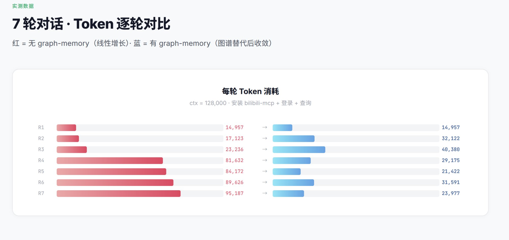
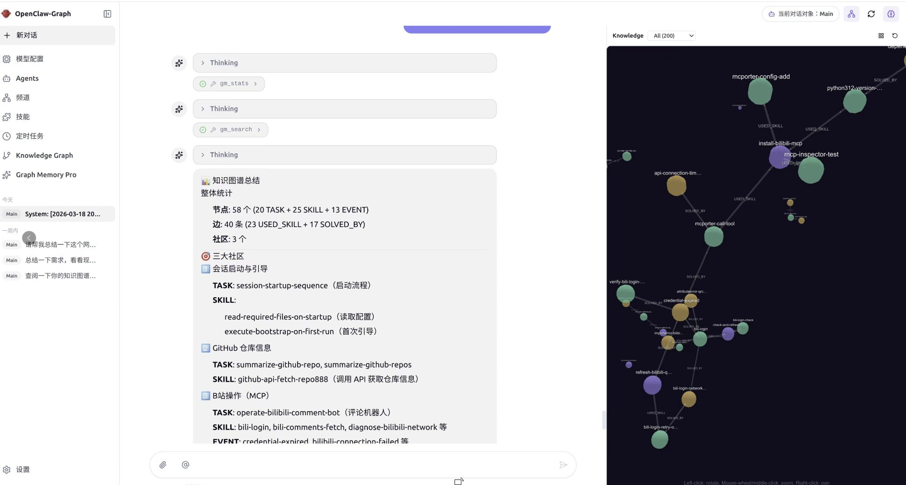
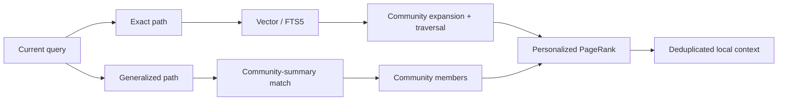
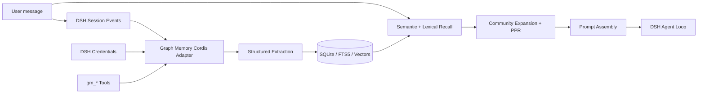
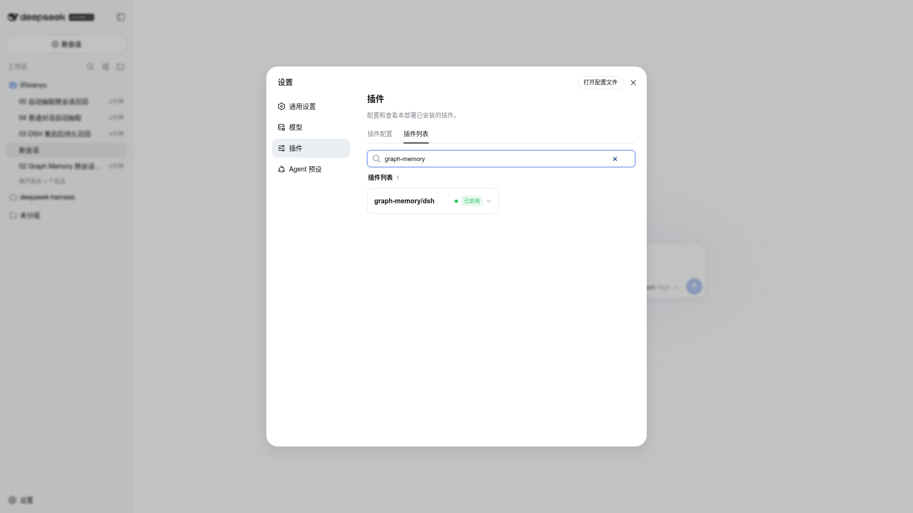
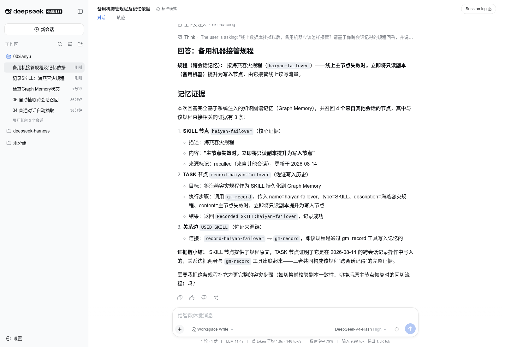
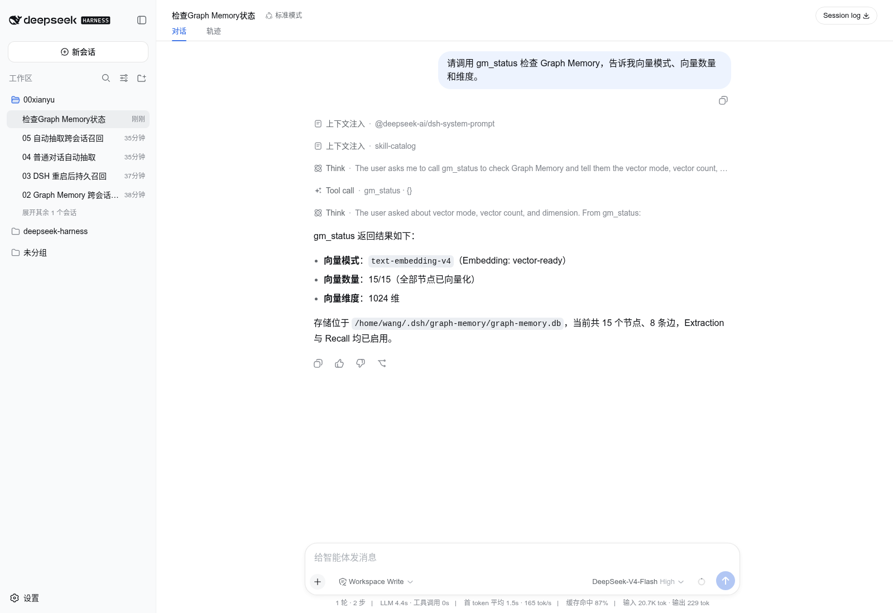

# Graph Memory


<p align="center">
  <strong>Traceable, searchable, cross-session memory for AI agents.</strong><br>
  One memory core, native to DeepSeek Harness, with the OpenClaw plugin entry retained.
</p>

<p align="center">
  <a href="README_CN.md">中文</a> ·
  <a href="#core-advantages">Advantages</a> ·
  <a href="#graph-memory-architecture">Architecture</a> ·
  <a href="#install-on-deepseek-harness">DSH Install</a> ·
  <a href="#graph-memory-pro-as-a-dsh-plugin">Pro Plugin</a> ·
  <a href="docs/DSH_NATIVE_PLAN.md">Technical Report (Chinese)</a>
</p>

Compaction answers “how much of this conversation still fits?” Graph Memory answers “which past knowledge is worth recalling now?”

Reusable conversation knowledge becomes typed nodes:

- `TASK`: goals, execution, and outcomes;
- `SKILL`: validated reusable methods;
- `EVENT`: errors, fixes, decisions, changes, and facts.

Typed edges such as `USED_SKILL`, `SOLVED_BY`, `REQUIRES`, `PATCHES`, and `CONFLICTS_WITH` preserve relationships. A new question retrieves a relevant local subgraph instead of replaying the complete history.

## Core advantages

### Native host integration

- Loaded by the DSH/Cordis plugin lifecycle, not simulated through an MCP side channel.
- Integrates Session, Tool, Agent Loop, Prompt Assembly, LLM, and Credentials seams.
- Disposes database, cache, and event listeners with its plugin fiber.
- Does not fork or modify DeepSeek Harness core.

### Durable cross-session memory

- Knowledge from Session A can be recalled automatically in Session B.
- Memory survives DSH restarts.
- Stable event IDs make resume and HMR ingestion idempotent.
- Source sessions and graph edges explain why a memory was recalled.

### Smaller, cleaner context

- Semantic vector retrieval with FTS5 lexical fallback.
- Community detection, PageRank, personalized PageRank, and bounded graph traversal.
- Only a relevant local subgraph enters the current prompt.
- Recalled history is marked as untrusted reference material and cannot override current user instructions.

### Local-first and lightweight

- Community uses SQLite by default; no graph database deployment is required.
- Embeddings are optional. Without them, recall falls back to FTS5.
- Data remains in the user's local profile by default.
- OpenAI-compatible embeddings support DashScope, OpenAI, and local providers.

### Observable and verifiable

- `gm_status` reports store path, graph counts, vector coverage, mode, and dimensions.
- Model or dimension changes trigger re-embedding.
- Vectors with different dimensions are never silently compared.
- Critical knowledge can be recorded deterministically with `gm_record`.

### Scoped token benchmark

The original OpenClaw adapter was measured in a seven-turn workflow that installed, authenticated, and queried `bilibili-mcp`:

<p align="center">
  
</p>

| Turn | Without Graph Memory | With Graph Memory |
|---|---:|---:|
| R1 | 14,957 | 14,957 |
| R4 | 81,632 | 29,175 |
| R7 | **95,187** | **23,977** |

The measured reduction at R7 was approximately **75%** in that specific workflow. This is a scenario-level comparison, not a universal savings guarantee; the mechanism is replacing indiscriminate history replay with a relevant knowledge subgraph.

## Project evolution

The DSH integration does not discard the original project. Graph Memory is evolving from an OpenClaw memory plugin into a graph-memory core that different agent harnesses can load natively.

| Stage | Deliverable | Status |
|---|---|---|
| OpenClaw origin | Context Engine, cross-session graph memory, dual-path recall | Maintained |
| Community graph engine | SQLite, FTS5, vectors, graph ranking, provenance | Available |
| DeepSeek Harness | Cordis adapter, native tools, auto-recall, Credentials | Implemented and tested |
| Graph Memory Pro | Visual graph workbench, controlled drag-and-drop, optional Neo4j | Architecture reviewed; DSH Host and Client Plugins not yet implemented |

On March 15, 2026, the project owner presented Graph Memory's architecture at the CLAW program event held in Tsinghua Science Park. The following owner-supplied materials and the [Sina Finance event report](https://cj.sina.com.cn/articles/view/7984421895/1dbe89c0700101nnpq) document that development.

<p align="center">
  
  
</p>

- [Community cross-session memory demo](https://www.bilibili.com/video/BV1xUcZzfEaB/)
- [Graph Memory Pro technical presentation](https://www.bilibili.com/video/BV1KwwzzGEvD/)

The image below is the existing OpenClaw / ClawX-era Pro graph prototype. It demonstrates a previously explored interaction direction; it is not a shipped DSH frontend.

<p align="center">
  
</p>

Names and venue information document project history only and do not imply endorsement by Tsinghua University, Sina Finance, DeepSeek, or OpenClaw.

## Graph Memory architecture

### Typed knowledge graph

```text
TASK   ──USED_SKILL──▶ SKILL
TASK   ──SOLVED_BY───▶ EVENT
SKILL  ──REQUIRES────▶ SKILL
EVENT  ──PATCHES─────▶ SKILL
SKILL  ──CONFLICTS_WITH──▶ SKILL
```

Nodes retain episodic user/assistant provenance. This preserves the context in which knowledge was created, not only a lossy summary.

### Dual-path recall



### Host data flow



The code follows a host-neutral core plus host adapters:

```text
graph-memory/
├── dsh.ts                 # DeepSeek Harness / Cordis adapter
├── index.ts               # OpenClaw adapter
├── cordis.patch.yml       # DSH bundle entry
└── src/
    ├── extractor/         # conversation → TASK / SKILL / EVENT
    ├── recaller/          # vector, FTS5, graph expansion and recall
    ├── graph/             # PageRank, communities and deduplication
    ├── store/             # SQLite schema and queries
    ├── format/            # safe context assembly
    └── engine/            # LLM and embedding providers
```

## Native DeepSeek Harness status

| Capability | Status | Notes |
|---|---|---|
| Native Cordis loading | **Done** | No DSH fork required |
| Cross-session auto-recall | **Done** | Injected during Prompt Assembly |
| Explicit record and search | **Done** | `gm_record`, `gm_search` |
| Vector backfill and migration | **Done** | Model, dimension, and fingerprint tracked |
| Visible plugin state | **Done** | Active in Plugin Inventory |
| Pro visual workbench | **Not shipped** | Requires a DSH Client Plugin |

Current beta: `1.6.0-beta.2`. Local acceptance used DeepSeek Harness `0.1.0-rc.5`. DSH remains in Developer Preview and may introduce compatibility-breaking changes. Testing covered tarball installation, active plugin state, 1024-dimensional vector backfill, semantic recall across Sessions, persistence across restarts, and FTS5 fallback. All 107 automated tests passed.

<p align="center">
  <strong>Plugin enabled: graph-memory/dsh is active in the DSH plugin list</strong><br>
  
</p>

<p align="center">
  <strong>Cross-session semantic recall in a fresh Session</strong><br>
  
</p>

## Install on DeepSeek Harness

Prerequisites: Node.js `22.19+` or `24+`. The current beta is not yet published to npm, so build the tarball from source:

```bash
git clone https://github.com/123caiji/dsh-memory-toolkit.git
cd graph-memory
npm ci
npm test
npm run build
npm pack
```

Install the generated tarball into the DSH Web profile:

```bash
npx @deepseek-ai/dsh plugin --profile web add /absolute/path/to/graph-memory-1.6.0-beta.2.tgz
npx @deepseek-ai/dsh --profile web --dump-config
npx @deepseek-ai/dsh web

# From a deepseek-harness source checkout:
pnpm dsh plugin --profile web add /absolute/path/to/graph-memory-1.6.0-beta.2.tgz
pnpm dsh web
```

After installation, verify that `graph-memory/dsh` is enabled under **Settings → Plugins → Plugin list**.

Default store:

```text
$DSH_HOME/graph-memory/graph-memory.db
```

Without `DSH_HOME`, this is normally `~/.dsh/graph-memory/graph-memory.db`.

## Optional vector retrieval

Do not send secrets in chat. Cordis stores only a credential reference; DSH `credentials` resolves the real value for each embedding operation.

DashScope example:

```bash
export GRAPH_MEMORY_EMBEDDING_API_KEY='replace-with-your-key'
export GRAPH_MEMORY_EMBEDDING_BASE_URL='https://dashscope.aliyuncs.com/compatible-mode/v1'
export GRAPH_MEMORY_EMBEDDING_MODEL='text-embedding-v4'
export GRAPH_MEMORY_EMBEDDING_DIMENSIONS='1024'
dsh web
```

Without embeddings, Graph Memory continues with FTS5 and does not block conversation.



## DSH tools

| Tool | Purpose |
|---|---|
| `gm_status` | Plugin, store, extraction, recall, and vector state |
| `gm_search` | Explicit long-term graph search |
| `gm_record` | Persist a TASK, SKILL, or EVENT |
| `gm_stats` | Node, edge, type, and community statistics |

Automatic recall does not require an explicit `gm_search` tool call. The plugin retrieves relevant memory during Prompt Assembly.

## Development

```bash
npm ci
npm test
npm run build
npm pack
```

Release checks:

- tests and TypeScript build pass;
- tarball contains `dist/dsh.js` and `cordis.patch.yml`;
- no API keys, local databases, or environment files enter the repository;
- planned Pro features are never presented as shipped Community behavior.

## Current limitations

- Automatic extraction depends on auxiliary-model output stability. Use `gm_record` for critical beta knowledge.
- DSH does not yet expose `gm_update` and `gm_maintain`; those remain OpenClaw-entry tools.
- The Pro DSH visualization client plugin is not implemented.
- npm registry publication is pending; install the current beta from a GitHub-built tarball.

## Privacy and security

- Memory remains in local SQLite by default.
- API keys come from host credentials or environment variables, not the database or Cordis patch.
- Recalled history is reference material; current user instructions always take precedence.
- Rotate any secret that has appeared in chat, logs, or screenshots.

## License

[MIT](LICENSE) © 2026 adoresever, 123caiji

See [docs/ATTRIBUTIONS.md](docs/ATTRIBUTIONS.md) for asset, logo, and trademark notes.
