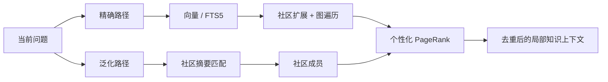
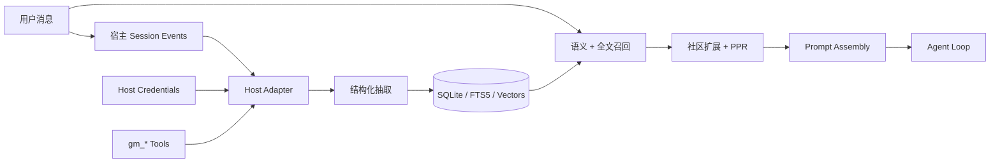

# Graph Memory


<p align="center">
  <strong>为 AI Agent 提供可检索、可追溯、跨会话的长期记忆</strong><br>
  一个宿主无关的图记忆内核，原生接入 DeepSeek Harness，并继续兼容 OpenClaw。
</p>

<p align="center">
  <a href="README.md">English</a> ·
  <a href="#核心优势">核心优势</a> ·
  <a href="#图记忆架构">图架构</a> ·
  <a href="#安装到-deepseek-harness">DSH 安装</a> ·
  <a href="#graph-memory-pro如何作为-dsh-插件集成">Pro 插件</a> ·
  <a href="docs/DSH_NATIVE_PLAN.md">技术报告</a>
</p>

Graph Memory 不是聊天记录归档器，也不是把所有历史重新塞回上下文。它把对话中的任务、技能、事件和因果关系沉淀为类型化知识图谱，在新问题出现时只召回相关的局部子图。

## 核心优势

### 一套内核，两个原生宿主入口

- **DeepSeek Harness**：通过 Cordis 生命周期接入 Session、Tool、Agent Loop、Prompt Assembly、LLM 与 Credentials；不修改 DSH 核心源码。
- **OpenClaw**：保留原有 Context Engine 插件入口、配置方式和数据能力。
- **共享内核**：抽取、SQLite 存储、FTS5、向量检索、社区发现、PageRank 和上下文组装不绑定单一宿主。

### 把历史变成可复用知识

- 跨 Session 召回，宿主重启后仍然保留。
- `TASK`、`SKILL`、`EVENT` 三类节点表达目标、方法、结果、错误与决策。
- `USED_SKILL`、`SOLVED_BY`、`REQUIRES`、`PATCHES`、`CONFLICTS_WITH` 五类关系保留因果和依赖。
- 节点关联原始会话证据，能够解释“这条记忆从哪里来、为什么被召回”。

### 只把相关知识送进上下文

- 精确路径：向量 / FTS5 → 社区扩展 → 图遍历 → 个性化 PageRank。
- 泛化路径：查询向量 → 社区摘要 → 社区成员 → 图排序。
- 只注入与本轮问题相关的局部图，不回放全部历史。
- 召回内容被标记为不可信参考材料，不能覆盖当前用户指令。

### 本地优先，向量能力可选

- Community 默认使用 SQLite，无需部署独立图数据库。
- 未配置 Embedding 时自动使用 FTS5，不阻断对话。
- 支持 OpenAI-compatible Embedding 接口，可接 DashScope、OpenAI 或本地服务。
- `gm_status` 显示数据库、节点、边、检索模式、向量覆盖率和维度。

### 限定场景下的 Token 实测

旧版 OpenClaw 入口曾在“安装 bilibili-mcp → 登录 → 查询”的 7 轮连续任务中进行对照测试：

<p align="center">
  
</p>

| 轮次 | 无 Graph Memory | 有 Graph Memory |
|---|---:|---:|
| R1 | 14,957 | 14,957 |
| R4 | 81,632 | 29,175 |
| R7 | **95,187** | **23,977** |

该场景第 7 轮减少约 **75%** Token。它是一个特定工作流的对照结果，不代表所有任务都有固定压缩比例；核心机制是用相关知识子图替代无差别历史回放。

## 项目发展

Graph Memory 的方向没有因为新宿主而推倒重来。项目正在从“OpenClaw 上的记忆插件”，发展为“可被不同 Agent Harness 原生加载的图记忆内核”。

| 阶段 | 交付内容 | 状态 |
|---|---|---|
| OpenClaw 起点 | Context Engine、跨会话图记忆、双路径召回 | 保持兼容 |
| Community 图引擎 | SQLite、FTS5、向量、图排序、溯源 | 可使用 |
| DeepSeek Harness | Cordis 适配器、原生工具、自动召回、Credentials | 已完成并实测 |
| Graph Memory Pro | 可视化图工作台、受控拖拽、Neo4j 可选适配器 | 架构已审计，DSH Host / Client Plugin 待实现 |

2026 年 3 月 15 日，项目负责人在清华科技园举办的 CLAW 蜕壳计划活动中分享了 Graph Memory 的架构思路。以下为项目负责人提供的现场材料与[新浪财经活动报道](https://cj.sina.com.cn/articles/view/7984421895/1dbe89c0700101nnpq)。

<p align="center">
  
  
</p>

- [开源版跨会话记忆演示](https://www.bilibili.com/video/BV1xUcZzfEaB/)
- [Graph Memory Pro 技术分享](https://www.bilibili.com/video/BV1KwwzzGEvD/)

下图是既有 OpenClaw / ClawX 阶段的 Pro 图谱原型，用于说明已经验证过的图交互方向；它不是当前 DSH 版本已经交付的前端。

<p align="center">
  
</p>

相关名称与现场信息仅用于项目履历记录，不表示清华大学、新浪财经、DeepSeek 或 OpenClaw 对本项目提供官方背书。

## 图记忆架构

### 类型化知识图谱

```text
TASK   ──USED_SKILL──▶ SKILL
TASK   ──SOLVED_BY───▶ EVENT
SKILL  ──REQUIRES────▶ SKILL
EVENT  ──PATCHES─────▶ SKILL
SKILL  ──CONFLICTS_WITH──▶ SKILL
```

- **TASK**：做过什么，包含目标、过程和结果。
- **SKILL**：经过验证、可以复用的方法或能力。
- **EVENT**：错误、修复、决策、变化和关键事实。
- **Episodic provenance**：图节点关联原始 user / assistant 片段，保留形成知识时的语境。

### 双路径召回



同一张图会根据当前问题产生不同排名。查询 Docker 时，Docker 相关技能靠前；查询 Conda 时，环境管理相关技能靠前。对几千节点规模的图，图排序可以在本地完成。

### 宿主数据流



```text
graph-memory/
├── dsh.ts                 # DeepSeek Harness / Cordis 适配器
├── index.ts               # OpenClaw 适配器
├── cordis.patch.yml       # DSH Bundle 安装入口
└── src/
    ├── extractor/         # 对话 → TASK / SKILL / EVENT
    ├── recaller/          # 向量、FTS5、社区扩展与召回
    ├── graph/             # PageRank、社区检测、去重
    ├── store/             # SQLite schema 与查询
    ├── format/            # 安全上下文组装
    └── engine/            # LLM / Embedding provider
```

## DeepSeek Harness 原生适配状态

| 能力 | 状态 | 说明 |
|---|---|---|
| Cordis 原生加载 | **已完成** | 使用插件生命周期，无需 fork DSH |
| 跨会话自动召回 | **已完成** | 在 Prompt Assembly 阶段注入相关记忆 |
| 显式记录与搜索 | **已完成** | `gm_record`、`gm_search` |
| 向量回填与模型迁移 | **已完成** | 追踪模型、维度与 fingerprint |
| 插件状态可见 | **已完成** | 设置页 Plugin Inventory 显示 active |
| Pro 可视化工作台 | **未交付** | 需要 DSH Client Plugin |

当前 beta：`1.6.0-beta.1`。本机验收宿主为 DeepSeek Harness `0.1.0-rc.5`；DSH 仍处于 Developer Preview，后续版本可能出现破坏性变化。验收已覆盖 tarball 安装、插件 active、1024 维向量回填、跨 Session 语义召回、重启持久化和 FTS5 降级；107 项自动化测试通过。

<p align="center">
  <strong>插件已启用：graph-memory 在 DSH 插件列表中处于 active</strong><br>
  
</p>

<p align="center">
  <strong>跨会话语义召回：新 Session 召回上一 Session 的知识</strong><br>
  
</p>

## 安装到 DeepSeek Harness

前置条件：Node.js `>= 20`（推荐 22.19+ 或 24+）。

### 方式一：从 GitHub 安装（推荐）

```bash
dsh plugin add github:123caiji/dsh-memory-toolkit --subdir packages/graph-memory
```

或克隆后本地安装：

```bash
git clone https://github.com/123caiji/dsh-memory-toolkit.git
cd dsh-memory-toolkit
pnpm install
dsh plugin add ./packages/graph-memory
```

### 方式二：网页端安装

1. 启动 DSH Web：`dsh web`
2. 访问 `http://127.0.0.1:3080`
3. 进入 **设置 → 插件 → 添加**
4. 填入 `github:123caiji/dsh-memory-toolkit`

### 验证

```bash
dsh plugin list    # graph-memory 应为 active
```

在 DSH 会话中调用 `gm_status` 确认数据库已初始化。

### 数据库路径

默认：`~/.dsh/graph-memory/graph-memory.db`

覆盖：在 profile 的 `cordis.patch.yml` 中修改 `dbPath`：

```yaml
- insert:
    - id: graph-memory
      name: '@123caiji/dsh-graph-memory'
      config:
        dbPath: /your/custom/path/graph-memory.db
        recallMaxNodes: 10      # 召回最大节点数（默认 6）
        recallMaxDepth: 3       # 召回深度（默认 2）
```

### 向量检索配置（可选）

不配置时自动回退 SQLite FTS5 全文检索。配置后启用语义向量召回：

```bash
setx GRAPH_MEMORY_EMBEDDING_API_KEY "your-api-key"
setx GRAPH_MEMORY_EMBEDDING_BASE_URL "https://api.deepseek.com/v1"
setx GRAPH_MEMORY_EMBEDDING_MODEL "text-embedding-v1"
setx GRAPH_MEMORY_EMBEDDING_DIMENSIONS "1024"
```

重启 DSH 后生效。验证：调用 `gm_status`，`vectorEnabled` 应为 `true`。

<p align="center">
  
</p>

### DSH 原生工具

| 工具 | 作用 |
|---|---|
| `gm_status` | 查看插件、数据库、抽取、召回和向量状态 |
| `gm_search` | 主动搜索长期知识图谱 |
| `gm_record` | 确定性记录 TASK、SKILL 或 EVENT |
| `gm_stats` | 查看节点、边、类型与社区统计 |

自动召回不要求模型主动调用 `gm_search`；适配器会在 Prompt Assembly 阶段检索并注入相关记忆。

## 开发与验证

`ash
npm ci
npm test
npm run build
npm pack
```

发布前必须确认：测试与 TypeScript 构建通过；tarball 包含 `dist/dsh.js` 与 `cordis.patch.yml`；仓库不存在 API key、本地数据库和环境文件；文档不把 Pro 路线图写成已完成功能。

## 当前限制

- 自动抽取依赖辅助模型输出稳定性；关键知识在 beta 阶段建议使用 `gm_record`。
- DSH 版暂未提供 `gm_update` 和 `gm_maintain`，这两个工具目前属于 OpenClaw 入口。
- Pro 的 DSH Client Plugin 尚未实现。
- npm registry 发布尚未完成，当前使用 GitHub 源码 tarball 安装。

## 隐私与安全

- 数据默认保存在本机 SQLite。
- API key 通过宿主凭据或环境变量注入，不写入数据库和 Cordis patch。
- 召回历史只作为参考；当前用户指令始终拥有更高优先级。
- 曾出现在聊天、日志或截图中的密钥应立即轮换。

## 许可证

[MIT](LICENSE) © 2026 adoresever, 123caiji

graph-memory 衍生自 [adoresever/graph-memory](https://github.com/adoresever/graph-memory)（MIT）。
